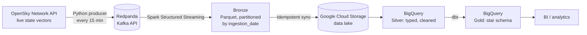

# Real-Time Aviation Telemetry Pipeline

A streaming data pipeline that ingests live aircraft positions, lands them in a cloud data lake and models them in BigQuery into analytics-ready tables for operations monitoring and anomaly detection.

The same pattern applies to any business that tracks moving assets: delivery fleets, logistics vehicles, field equipment or IoT sensors.

---

## Architecture



| Layer | Where | What it holds |
|---|---|---|
| **Bronze** | Local Parquet, then GCS | Raw JSON payload per aircraft event, exactly as received, plus ingestion metadata |
| **Silver** | BigQuery (dbt, incremental) | Parsed, typed and cleaned telemetry, one row per aircraft event |
| **Gold** | BigQuery (dbt) | Dimension and fact tables for reporting: aircraft catalogue, daily metrics, out-of-envelope flights |

---

## Tech stack

| Area | Tools |
|---|---|
| Ingestion | Python, `requests`, `kafka-python` |
| Streaming | Redpanda (Kafka-compatible broker), Docker Compose |
| Processing | Apache Spark 3.5 (PySpark Structured Streaming) |
| Storage | Parquet with Hive partitioning, Google Cloud Storage |
| Warehouse | Google BigQuery |
| Transformation | dbt, Standard SQL |
| Modelling | Medallion architecture, dimensional modelling (star schema) |

---

## How it works

### 1. Ingestion: `ingestion/opensky_ingest.py`
- Polls the OpenSky `/states/all` endpoint every 15 minutes, which keeps it within the daily limit for anonymous access (400 credits, 4 per call).
- Splits each response into individual aircraft records and publishes them **one event per aircraft** to the `vuelos_telemetria` topic.
- Logs only record counts, never full payloads, to keep memory and log volume flat.
- API failures are logged and the loop continues, so a single failed call does not stop ingestion.

### 2. Streaming to Bronze: `spark/spark_processor.py`
- Spark Structured Streaming subscribes to the topic.
- Keeps the payload **untouched** as a JSON string and adds two metadata columns: `ingested_at` (broker timestamp) and `ingestion_date`.
- Writes Parquet partitioned by `ingestion_date` (`ingestion_date=YYYY-MM-DD/`).
- A checkpoint directory tracks offsets, so restarts continue where they stopped without duplicating or losing events.

### 3. Data lake sync: `cloud/gcp_loader.py`
- Uploads Bronze Parquet files to a GCS bucket, **preserving the Hive partition layout** so BigQuery and other engines can prune by date.
- Idempotent: files already in the bucket are skipped, so the job can run on any schedule without creating duplicates.

### 4. Silver and Gold in BigQuery (dbt)
- **Silver** (`silver_telemetria`) parses the raw payload into typed columns. It is an incremental model: each run replaces only the latest day and the day before it, so re-runs never duplicate rows.
- **Gold** is a star schema:
  - `gold_dim_aircraft`: one row per aircraft with its latest attributes (SCD Type 1, deduplicated with `QUALIFY ROW_NUMBER()`).
  - `gold_daily_flight_metrics`: daily fact table per aircraft (ping count, max velocity, max altitude).
  - `gold_anomalous_flights`: aircraft above typical commercial speed or altitude.
- Data quality tests run on Silver (coordinates, speeds, altitudes, ground reports) and on Gold (keys, relationships, accepted values).

See [`docs/data-dictionary.md`](docs/data-dictionary.md) for the column-level schema of every layer and [`docs/gold-layer.md`](docs/gold-layer.md) for the Gold rules.

### 5. Reference data: airports
The quality tests compare aircraft reported on the ground with the elevation of the nearest airport. The airport list comes from [OurAirports](https://ourairports.com/data/) (`airports.csv`, public domain).

`dbt/seeds/airports_filter.py` reduces the original file (about 86,000 rows) to the 5,282 large and medium airports and keeps only the columns the tests need. The result, `ref_airports.csv`, is loaded into BigQuery with `dbt seed`. The original file (12 MB) is kept locally in `dbt/data/raw/airports_info.csv` and excluded from version control. To rebuild the seed, download `airports.csv` from the link above, save it at that path and run the script from the project root:

```bash
python dbt/seeds/airports_filter.py
```

Airports without a known elevation are kept, and the altitude check is skipped for them.

---

## Design decisions

| Decision | Why |
|---|---|
| Bronze stores the raw payload as JSON | The source schema can change without breaking ingestion. Data can always be reprocessed from Bronze. |
| One Kafka event per aircraft | Downstream consumers process events independently and the stream scales by partition. |
| Redpanda instead of Apache Kafka | Same Kafka API, a single container, no ZooKeeper. Suitable for a single-node setup. |
| Hive partitioning by ingestion date | Date-based pruning in Spark, GCS and BigQuery, and cheap reprocessing of a single day. |
| Incremental Silver with `insert_overwrite` | Events have no unique key, so whole day partitions are replaced. Re-runs are safe and late data from the previous day is picked up. |
| Defensive casting (`SAFE_CAST`) in the warehouse | Malformed sensor values become `NULL` instead of failing the pipeline. |
| Star schema in Gold | Static attributes are stored once in a dimension, so fact tables stay narrow and scan less data in BigQuery. |
| Ground altitude checked against the nearest airport | A fixed threshold flags every aircraft parked at a high-elevation airport. Comparing with the real airport elevation (within 5 km, 300 m tolerance for pressure variation) removes those false positives. |

---

## Repository structure

| Path | Contents |
|---|---|
| `ingestion/opensky_ingest.py` | API to Redpanda producer |
| `spark/spark_processor.py` | Redpanda to Bronze Parquet (streaming) |
| `cloud/gcp_loader.py` | Bronze to GCS (idempotent sync) |
| `dbt/models/` | Silver and Gold models, Gold tests in `gold/schema.yml` |
| `dbt/tests/` | Data quality tests on Silver |
| `dbt/seeds/` | Reference data (`ref_airports.csv`) and the script that builds it |
| `docs/` | Data dictionary and Gold layer rules |
| `docker-compose.yml` | Redpanda broker and console |

`data/` (local Bronze files and checkpoints) and `credentials/` are excluded from version control.

---

## Running locally

**Requirements:** Python 3.11, Java 11 or 17 (for Spark), Docker, a GCP project with a GCS bucket and BigQuery.

```bash
# 1. Start the broker (Redpanda console at http://localhost:8080)
docker compose up -d

# 2. Install dependencies
python -m venv venv
source venv/bin/activate        # Windows: venv\Scripts\activate
pip install -r requirements.txt

# 3. Start the producer
cd ingestion && python opensky_ingest.py

# 4. In a second terminal, start the stream processor
cd spark && python spark_processor.py

# 5. Sync Bronze to GCS (run on demand or on a schedule)
cd cloud && python gcp_loader.py

# 6. Build and test the warehouse models
cd dbt && dbt seed && dbt build
```

Each Python script uses paths relative to its own folder, so run it from that folder.

**GCP credentials:** place a service account key with write access to the bucket at `credentials/gcp_key.json`. Never commit this file.

---

## Roadmap

- Orchestration with Airflow: scheduled GCS sync and dbt runs.
- Event-time processing based on the aircraft's own position timestamp instead of ingestion time.
- Dashboard on top of the Gold layer.
